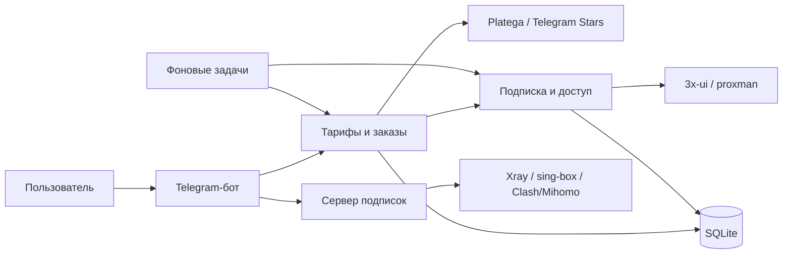

# rs8kvn_bot — биллинговая платформа VPN-подписок в Telegram

[](https://github.com/kereal/rs8kvn_bot/releases)
[](https://github.com/kereal/rs8kvn_bot/actions)
[](https://go.dev/)
[](https://github.com/kereal/rs8kvn_bot/actions)
[](LICENSE)

> **Self-hosted платформа для продажи, выдачи и сопровождения VPN-подписок прямо в Telegram.**

Это уже не просто бот. `rs8kvn_bot` объединяет витрину тарифов, заказы, оплату, управление доступом, контроль трафика, коммуникации и аудит в одном Go-приложении. Пользователь проходит путь от получения подписки до продления в привычном интерфейсе Telegram, а владелец сервиса сохраняет контроль над данными, платежами и VPN-инфраструктурой.

Telegram здесь — не только чат поддержки, а полноценный канал продаж и обслуживания. Ваша VPN-панель остаётся источником фактического доступа, а бот берёт на себя биллинг и ежедневную операционную работу вокруг него.

Нужен VPN? » [@kereal](https://t.me/kereal) · [Задать вопрос](https://t.me/kereal)

## Что получает владелец сервиса

| Контур | Что закрывает проект |
|---|---|
| **Продажи** | Тарифы, товары, заказы и выбор платёжного сценария без отдельного сайта. |
| **Биллинг** | Platega или Telegram Stars, подтверждение платежа и продление; оспаривание платежа для Platega и возврат Stars. |
| **Выдача доступа** | Создание подписки, синхронизация VPN-клиентов и единая ссылка для подключения. |
| **Клиентский опыт** | Карточка подписки, QR-код, trial по приглашению, реферальные ссылки и понятные уведомления. |
| **Удержание** | Напоминания о сроке и трафике, предложение продления, восстановление доступа после сброса квоты. |
| **Операции** | Рассылки с фильтрами, повтор ошибок доставки, статистика, аудит и контроль состояния сервиса. |

Итог — компактный self-hosted контур **«продажа → оплата → доступ → сопровождение»**, а не набор разрозненных скриптов.

## Возможности

### Для подписчика

- **Получение подписки без лишних шагов.** Бот создаёт или открывает существующую подписку и показывает тариф, срок, трафик и ссылку.
- **Удобное подключение.** Ссылка и QR-код импортируются в Happ; сервер подписок также формирует профили Xray, sing-box и Clash/Mihomo.
- **Пробный доступ.** Инвайт-страница `/i/{code}` создаёт trial и предлагает открыть ссылку в Happ или привязать подписку к Telegram-аккаунту.
- **Покупка прямо из бота.** Пользователь выбирает товар; для Telegram Stars принимает условия и оплачивает встроенным счётом, для Platega переходит по платёжной ссылке. Отдельный личный кабинет сервиса не нужен.
- **Прозрачный контроль.** В боте видны состояние подписки, расход трафика, дата окончания и следующий сброс.
- **Напоминания вместо внезапного отключения.** Сервис заранее сообщает о приближении окончания срока и расходовании квоты.

### Для оператора

- **Настоящий каталог и биллинг.** Планы, товары и заказы связаны в единую систему; повторное уведомление об оплате не продлевает доступ второй раз.
- **Два платёжных сценария.** Platega работает через ссылку и защищённый callback; Telegram Stars — через встроенный invoice, проверку pre-checkout и автоматическую обработку успешной оплаты.
- **Продуманная работа с исключениями.** Дубли и несовпадения в платеже Telegram Stars автоматически возвращаются; повтор команды `/refund` не создаёт второй возврат. При оспаривании платежа доступ учитывает наличие других оплаченных заказов.
- **Многоузловая доставка.** Подписка может объединять несколько активных источников, а синхронизация клиентов переживает временную недоступность панели.
- **Рассылки как рабочий инструмент.** Кампании создаются и запускаются в веб-панели администратора: отправка сразу или по расписанию (московское время), фильтры аудитории, отмена и повтор именно ошибок доставки. Состояние сохраняется в базе и восстанавливается после перезапуска; воркер доставки продолжает работать в процессе бота.
- **Контроль доступа и история изменений.** В базе сохраняется история событий по заказам, подпискам, рассылкам и действиям администратора.

### Для владельца инфраструктуры

- **Один процесс вместо сложного стека.** Бот, HTTP-сервер, сервер подписок и фоновые задачи запускаются вместе.
- **Данные под вашим контролем.** Вы сами размещаете приложение, базу, секреты и VPN-панели; Telegram служит пользовательским интерфейсом, а оплату принимают выбранные внешние провайдеры.
- **Инструменты для повседневной эксплуатации.** Встроенные миграции, проверяемые резервные копии, проверки состояния, метрики Prometheus, Sentry и корректное завершение работы.
- **Более безопасный запуск в Docker.** Контейнер работает от непривилегированного пользователя, конфигурация подключается только для чтения, включены проверка состояния и защита от повышения привилегий.

## Как выглядит путь пользователя

1. Пользователь открывает бота через `/start` или получает trial по инвайт-ссылке.
2. Бот создаёт подписку и выдаёт ссылку, инструкцию и QR-код для импорта; trial можно привязать к Telegram-аккаунту.
3. В карточке подписки пользователь видит тариф, трафик, срок и доступные действия.
4. При необходимости выбирает Premium-товар и оплачивает его через Platega или Telegram Stars.
5. Бот подтверждает заказ, продлевает подписку и синхронизирует доступ на нужных VPN-узлах.
6. В дальнейшем сервис сам напоминает о сроке и квоте, а оператор может связаться с аудиторией через рассылку.

## Архитектура в одном взгляде



Поддерживаемые источники VPN:

| Источник | Роль |
|---|---|
| **3x-ui** | Управление клиентами, трафиком и профилями панели. |
| **proxman** | Поддерживаемый тип управляемого узла; доступные операции зависят от реализации API. |
| **fetch** | Read-only источник внешней подписки без управления клиентами. |

Подписки выдаются в форматах **Xray JSON**, **sing-box JSON** и **Clash/Mihomo YAML**. sing-box и Clash/Mihomo можно запросить через `?format=`; иначе формат подбирается по приложению-клиенту, а для неизвестного клиента используется Xray.

## Быстрый старт

Нужны Docker, токен Telegram-бота, Telegram ID администратора и хотя бы один настроенный источник VPN. Для публичных ссылок подписки используйте HTTPS-адрес.

```bash
cp .env.example .env
# Заполните TELEGRAM_BOT_TOKEN, TELEGRAM_ADMIN_ID и GLOBAL_SUB_URL

mkdir -p data
sudo chown -R 1000:1000 data
chmod 600 .env

docker compose pull
docker compose up -d
```

Проверьте состояние приложения:

```bash
curl -fsS http://127.0.0.1:8880/healthz
curl -fsS http://127.0.0.1:8880/readyz
docker compose logs -f rs8kvn_bot
```

После запуска добавьте VPN-узел в базу и свяжите его с нужным планом — подробный сценарий есть в **[руководстве по установке](doc/installation.md)**. Там же описаны все переменные окружения, настройка 3x-ui, миграции и резервные копии.

> По умолчанию HTTP-сервер слушает `8880` (`WEB_SERVER_PORT`) и в production Compose публикуется только на localhost. Для внешнего доступа используйте reverse proxy с HTTPS.
>
> Рабочий каталог `data/` должен быть доступен UID `1000`; рядом с SQLite создаются файлы `-wal` и `-shm`.
>
> Штатная модель — один экземпляр приложения, одна SQLite-база и один Telegram-токен. Не запускайте два процесса с одной базой.
>
> Для воспроизводимых развёртываний замените `latest` в Compose на конкретный SemVer- или SHA-тег.

Для локальной сборки используйте **[docker-compose.local.yml](docker-compose.local.yml)**. Запуск без Docker и ручная настройка перечислены в [руководстве по установке](doc/installation.md).

## Конфигурация

Минимально необходимые параметры:

| Переменная | Назначение |
|---|---|
| `TELEGRAM_BOT_TOKEN` | Токен бота от @BotFather. |
| `TELEGRAM_ADMIN_ID` | Telegram ID администратора для команд и уведомлений. |
| `GLOBAL_SUB_URL` | Публичная базовая ссылка для URL подписок, например `https://vpn.example.com/sub/`. |

Основные опции:

| Переменная | Назначение |
|---|---|
| `PAYMENT_ENABLED` | Включает витрину и оплату в боте. |
| `PAYMENT_PROVIDER` | Выбирает `platega` или `telegram_stars`. |
| `SITE_URL` | Базовый адрес web-инвайтов `/i/{code}`. |
| `NOTIFICATIONS_ENABLED` | Включает уведомления о сроке и трафике. Восстановление после сброса квоты продолжает работать и без них. |
| `METRICS_TOKEN` | Bearer-токен для защиты `/metrics`; задайте его на публичном порту. |
| `SENTRY_DSN` | Необязательный сбор ошибок и паник в Sentry. |

Полный список переменных и их значения по умолчанию — в **[`.env.example`](.env.example)** и [руководстве по установке](doc/installation.md).

## Команды и управление

### Пользовательские команды

| Команда | Назначение |
|---|---|
| `/start` | Главное меню; deep link `trial_...` привязывает trial к аккаунту и переводит его на free-план, `share_...` учитывает приглашение. |
| `/mysub` | Карточка текущей подписки, трафик, срок и ссылка. |
| `/help` | Справка по боту и подключению. |
| `/invite` | Постоянные Telegram- и web-ссылки для приглашения. |
| `/terms` | Пользовательское соглашение. |
| `/paysupport` | Поддержка по оплате и возвратам. |

### Административные команды

| Команда | Назначение |
|---|---|
| `/lastreg` | Последние активные регистрации. |
| `/del <subscription_id>` | Отозвать VPN-доступ и удалить подписку. |
| `/setplan <subscription_id> <plan_id> [days]` | Изменить план и срок, затем синхронизировать узлы. |
| `/send <telegram_id\|@username> <message>` | Отправить личное сообщение. |
| `/refstats` | Статистика приглашений и рефереров. |
| `/refund <order_id>` | Полный возврат Telegram Stars-заказа. |
| `/v` | Версия бота. |

Оператор также получает кнопки статистики и последних регистраций прямо в главном меню. Полные инструкции по рассылкам и эксплуатации — в [документации проекта](#документация).

## Публичные HTTP-интерфейсы

| Эндпоинт | Назначение |
|---|---|
| `GET, HEAD /healthz` | Сводная проверка состояния приложения, базы и последнего состояния доступных 3x-ui-узлов. |
| `GET, HEAD /readyz` | Проверка готовности после запуска. |
| `GET /i/{code}` | Web-страница trial по инвайт-коду. |
| `GET /sub/{subID}` | Агрегированная подписка в формате клиента. |
| `GET /metrics` | Prometheus-метрики; Bearer-защита включается через `METRICS_TOKEN`. |
| `POST /payment/callback` | Защищённый callback Platega. |
| `GET, HEAD /static/logo.png` | Встроенный логотип для web-страниц. |

Сервер подписок собирает доступные конфигурации узлов в единый ответ в формате выбранного клиента. Отозванная или истёкшая подписка не выдаётся даже при наличии ранее сохранённого ответа.

## Эксплуатация и надёжность

- **Платежи и доступ согласованы в базе.** Подтверждение заказа, продление подписки, аудит и подготовка синхронизации проходят одной транзакцией; внешняя синхронизация VPN-клиентов повторяется фоновым воркером при сбоях.
- **Истечение срока не требует ручной уборки.** Платный доступ переводится на free-план, а изменения узлов догоняются автоматически.
- **Квоты работают как часть продукта.** Сервис предупреждает о приближении лимита, фиксирует исчерпание и возвращает доступ после сброса трафика, если панель доступна.
- **Бэкапы выполняются автоматически.** Перед сохранением резервная копия SQLite проходит проверку целостности; миграции применяются при старте.
- **Состояние видно снаружи.** Доступны health/readiness-проверки, Prometheus-метрики, журналы приложения с ротацией и необязательный Sentry.
- **Безопасность начинается с развёртывания.** Используйте HTTPS, закрытый reverse proxy, `METRICS_TOKEN`, права `600` для `.env` и отдельные резервные копии вне хоста.

Ограничения текущей модели: продление требует новой покупки — автоматических повторных списаний нет. Приложение рассчитано на один экземпляр с SQLite; запуск нескольких экземпляров, автоматическое копирование резервных копий за пределы сервера и обновление без краткого перерыва не входят в проект.

## Релизы

GitHub Actions автоматически проверяет код. При публикации релизного тега создаются Docker-образ и GitHub Release.

```bash
git tag -a vX.Y.Z -m "Release vX.Y.Z"
git push origin vX.Y.Z
```

Опубликованные образы находятся в [GitHub Container Registry](https://github.com/kereal/rs8kvn_bot/pkgs/container/rs8kvn_bot), а исходный код и релизы — на [GitHub](https://github.com/kereal/rs8kvn_bot).

## Разработка

Требуется Go **1.27.4+**.

```bash
go test ./...
go test -race ./...
go vet ./...
go build -o rs8kvn_bot ./cmd/bot
golangci-lint run ./...
```

В проекте есть unit-, интеграционные, E2E-, smoke- и fuzz-тесты. Команды CI и локальной разработки также собраны в [Makefile](Makefile).

## Документация

| Документ | Для чего нужен |
|---|---|
| **[Установка и настройка](doc/installation.md)** | Docker, локальный запуск, переменные окружения, VPN-узлы, миграции и бэкапы. |
| **[Архитектура](doc/architecture.md)** | Слои приложения, модель данных, синхронизация и фоновые процессы. |
| **[HTTP API](doc/api.md)** | Эндпоинты, форматы ответов, коды ошибок и rate limits. |
| **[Эксплуатация](doc/operations.md)** | Мониторинг, обновление, откат, восстановление и Telegram Stars. |
| **[Админ-панель](doc/specs/admin/00-common.md)** | Контракт панели: экраны, API, права и ограничения ([АДР](doc/adr/0002-admin-panel-contract.md)). |
| **[Рассылки](doc/broadcast.md)** | Фильтры, планирование, доставка и повтор ошибок. |
| **[Журнал аудита](doc/audit-log.md)** | События, история сущностей и правила записи. |
| **[Политика безопасности](doc/security.md)** | Hardening, секреты, webhook и эксплуатационные ограничения. |
| **[Диаграммы](doc/diagrams/README.md)** | Визуальная карта компонентов и пользовательских потоков. |

## Лицензия

Проект распространяется по лицензии **[GNU AGPL-3.0](LICENSE)**.

Если проект оказался полезен — поставьте ⭐ репозиторию. Это лучший способ показать, что такой формат VPN-биллинга нужен.
